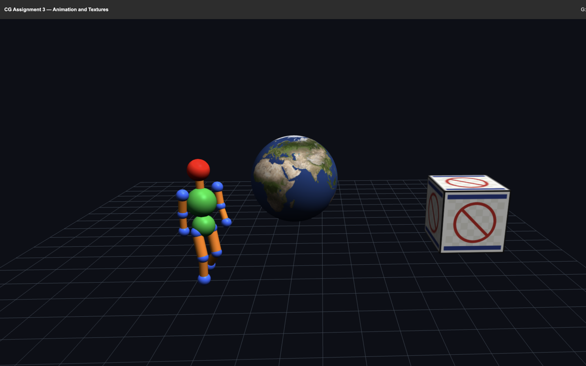
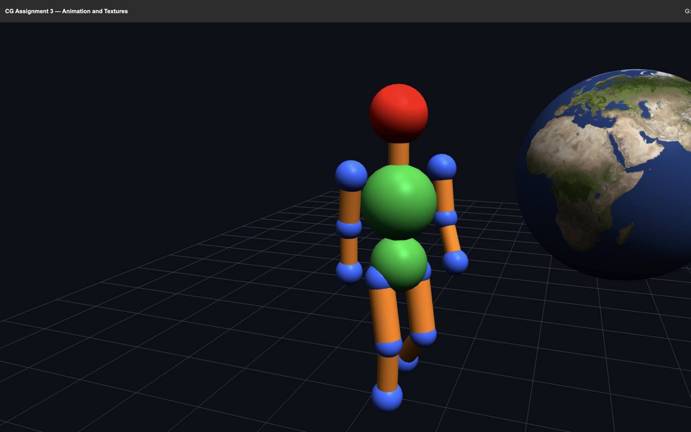
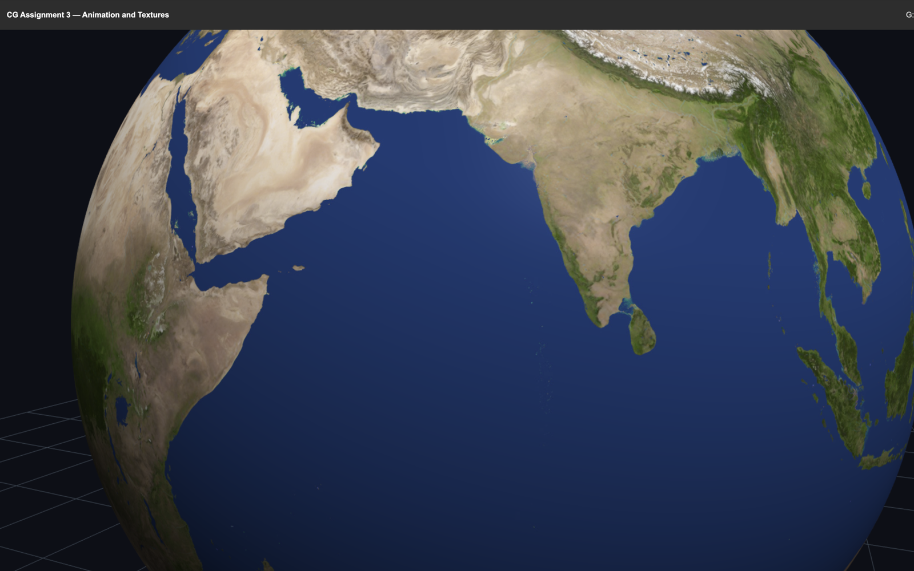
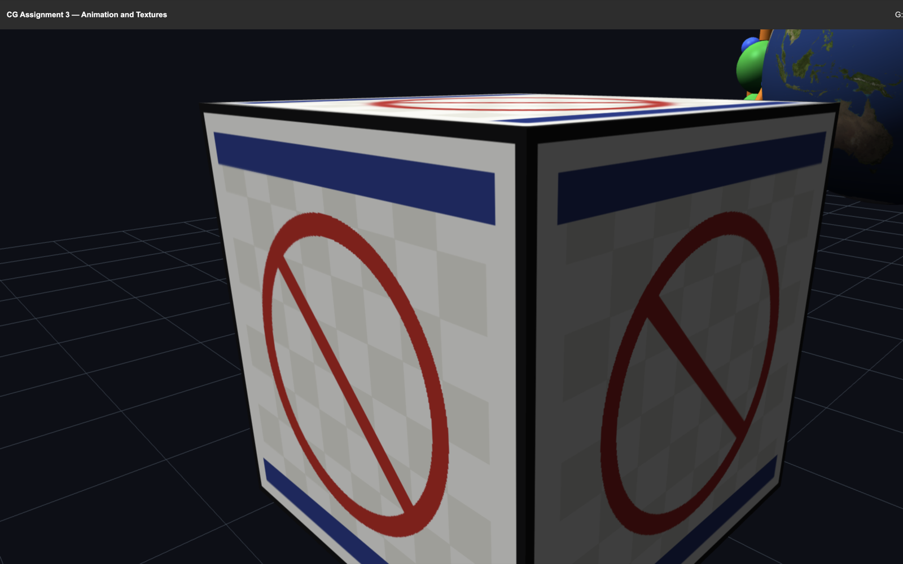

# Assignment 3 - Animation and Textures

Name: Chu Tianze (楚天泽)  
UCD Student ID: 24107737  
BDIC Student ID: 24372307

An articulated figure walks around a circle beside a rotating Earth and a textured cube. The hierarchy, the motion and the texture coordinates are computed in this project. Babylon.js supplies the window, camera, lights and render loop.

## Preview









## Run

Open a terminal in this project folder, then run:

```sh
cd starter
python3 -m http.server 8000
```

On Windows, use `python -m http.server 8000`. Open <http://localhost:8000>.
Babylon.js 9.35.0 is included in `starter/vendor/babylon.js`, so running the
project does not require an external CDN connection. Open it through the server
in Chrome, not by double-clicking the HTML. If WebStorm's embedded preview
is blank, open the local-server URL in Chrome instead.
No npm install or build step is needed.

- Drag / scroll: orbit and zoom the camera.
- G: switch between walking and sliding.
- Space: pause or resume both the figure and the globe.

## Implementation

### Part A - Hierarchical figure (`starter/src/figure.js`)

`buildArm()` and `buildLeg()` each accept a side (+1 or -1) and are called twice.
Every limb is positioned relative to its parent. The elbow follows the upper-arm
mesh, and the knee follows the thigh mesh. Their local offsets are `(0,0,length)`.
The fixed downward rest rotation is on the upper bone; the eight animated joints
start at zero. Moving the pelvis carries all the parts below it.

The leg lengths are 0.8 and 0.75, with foot radius 0.2 and hip offset -0.15.
At rest the pelvis is at y=1.9, putting the bottom of each foot on the ground.
The provided pelvis/chest/neck/head reference is retained.

### Part B - Time-based animation (`starter/src/animation.js`)

- Radius 4, one lap every 12 seconds: `theta = 2*pi*t/12`,
  `x = 4*cos(theta)`, `z = 4*sin(theta)`.
- The tangent is `(-sin(theta),0,cos(theta))`. Rotating local +z by yaw `-theta`
  makes the figure face this tangent.
- `phase = 16*theta` gives 16 full left/right gait cycles per lap. Opposite arms
  and legs advance together; the arm swing is `sin(phase + pi/2)`.
- Each foot stays at one world-space position during its support half-cycle.
  During the swing half-cycle, `u-sin(2*pi*u)/(2*pi)` moves it to the next contact
  point, and `0.22*sin(pi*u)^2` lifts it off the floor. Both curves have zero
  velocity at their ends, avoiding sudden take-off or landing.
- A two-segment inverse-kinematics calculation uses the cosine rule to find the
  knee bend and aims the hip at the foot target. A small hip roll compensates
  for turning around the circle. This calculation is written explicitly in
  `poseLeg()`; it does not use a library skeleton or animation system.
- Knees bend only in the positive local-x direction and elbows only in the
  negative direction. A small sinusoidal rise and fall keeps both legs in reach.
- Contact points are reconstructed from the step number and time. Pausing,
  skipping frames or evaluating times out of order does not change the pose.
- Sliding keeps the circular path but resets facing and all three rotation
  components of the eight animated joints.
- The globe rotates about its own Y axis with angle `2*pi*t/20`.

All transforms are recomputed from the supplied time. There are no per-frame
angle increments, Babylon Animation/AnimationGroup objects, or skeleton classes.

### Part C - Texture coordinates (`starter/src/textures.js`)

- Cube: six separately mapped faces, each showing the entire image. Outside-view
  corner order is bottom-left, bottom-right, top-right, top-left, mapped to
  `(0,0), (1,0), (1,1), (0,1)`. Side-face image-up is +y; top uses -z and bottom +z.
  Each face has an outward flat normal and is triangulated into two triangles.
- Sphere: the supplied latitude/longitude parameterisation supplies positions and
  radial unit normals. The lecture's normalised parameters are
  `u = theta/(2*pi) + 0.5` and `v = phi/pi + 0.5`.
  This starter's handedness and stand-up rotation make increasing theta read
  right-to-left from outside, so the emitted image coordinate is `1-u`, with `v`
  unchanged. An asymmetric letter chart was used to check that text is readable.
- The longitude seam uses separate UV endpoints at coincident positions; no
  triangle interpolates from one end of the entire map to the other. Degenerate
  pole triangles are omitted. Each supplied grid cell is subdivided 4x4 by
  default: 48x32 becomes 192x128, producing 48,768 nondegenerate triangles for
  a smooth close-up silhouette. The same explicit parametric geometry is used;
  passing `refinement=1` retains the original resolution.
- Sign: nearest sampling, clamp U and V. Map: bilinear sampling, wrap U, clamp V,
  with anisotropic filtering requested at level 8 (subject to GPU support).

### Earth texture

The original stylised map has been replaced by an 8192x4096 Earth day map from
[Solar System Scope / INOVE](https://www.solarsystemscope.com/textures/), licensed
under [CC BY 4.0](https://creativecommons.org/licenses/by/4.0/). The downloaded
JPEG was converted to PNG at its original resolution to retain the supplied
`assets/world.png` path. It shows detailed coastlines, terrain and polar ice.
Source links, the download mirror and conversion details are recorded in
`starter/assets/ATTRIBUTION.txt`. The image is bundled locally, so no online
texture request is needed when running the project.

## Connection to the supplied lectures

- Week 4, pp.49-59: cylinders, parameterised spheres, triangulation and normals.
- Week 4, pp.94 and 109-114: transformation order, composition and rotation pivots.
- Week 6 & 7, pp.19-20: model matrices and parent/child scene-graph transforms.
- `The world_model matrix.pdf`, p.2: child-local and parent-world composition.
- Week 6 & 7, pp.102-106: UVs, texture sampling and wrapping; p.113: render loop.

The foot-placement refinement additionally uses the cosine rule to solve the
thigh/shin triangle; it extends the basic sine-wave walk.

## Validation

Checked in Chrome with Babylon.js 9.35.0 (also included locally):

- Parent/child relationships, rest pose, whole-body movement and shoulder/hand inheritance.
- Circular path and tangent-facing direction across a complete lap.
- Identical poses at equal times after 30, 60 and 120 FPS update sequences.
- Knee/elbow bend signs; stationary support feet, ground clearance and smooth
  transitions between support and swing.
- G toggling, Space pause, 12-second lap and 20-second globe rotation.
- Finite vertex attributes, UV bounds/counts, outward triangle winding and unit normals.
- Cube has 12 triangles; textured sphere has 48,768, with no zero-area triangles.
- Continuous seam positions, local UV interpolation, and readable texture orientation.
- No JavaScript exceptions or failed application-resource requests during the checked run.

The provided `main.js`, `shapes.js`, `geometry.js`, `math.js`, `solids.js`,
and `style.css` are unchanged. `index.html` now loads the same Babylon.js build
from `vendor/babylon.js` to avoid blank pages when the external CDN is unreachable.

## Known limitations and submission status

The figure uses spherical feet and a prescribed walk cycle; it has no toe/heel
roll, collision detection or physical balance simulation. Equirectangular
textures stretch near the poles. The 8K map and refined sphere need more graphics
memory than the starter assets. Keep the bundled `vendor` directory inside
`starter` when moving or submitting the project.

Parts A-D are implemented. The student's demo video is still to be recorded and
must be included as `24107737_demo.mp4` (at most 90 seconds) before submission.
`assignment 3 demo.mp4` in the original project is the instructor's reference,
not the student's submission video. The supplied Moodle screenshot extends the
deadline to Tuesday, 17 November 2026; the original assignment document retains
its earlier date.

## Sources

The scene framework, math/solid helpers and sign image were supplied with the
assignment. The Earth image is credited above and in
`starter/assets/ATTRIBUTION.txt`. Babylon.js is distributed with its license in
`starter/vendor/license.md`.
